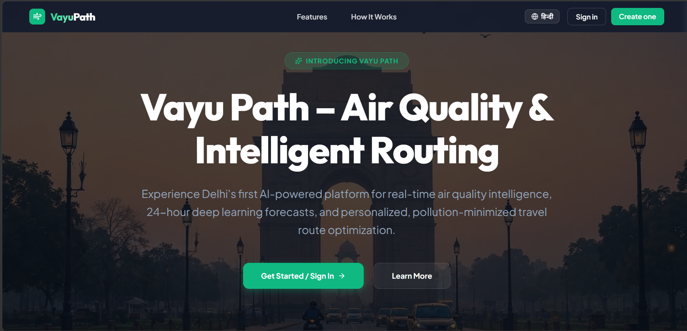
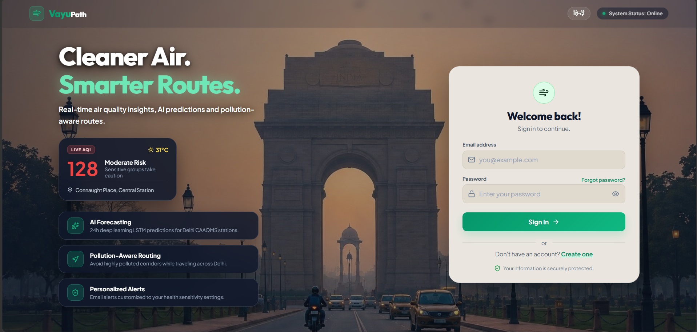
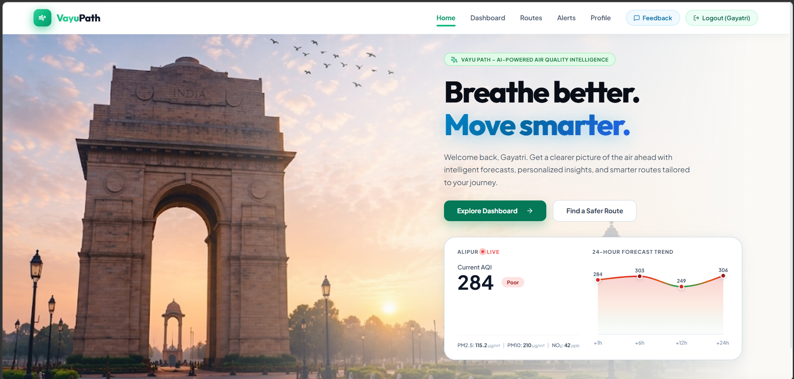
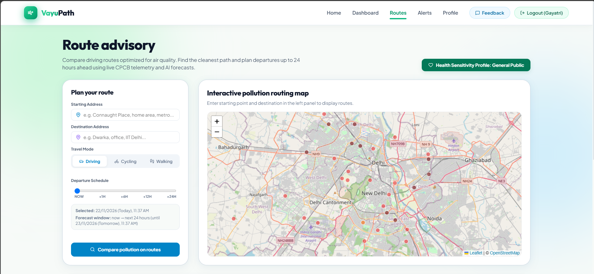
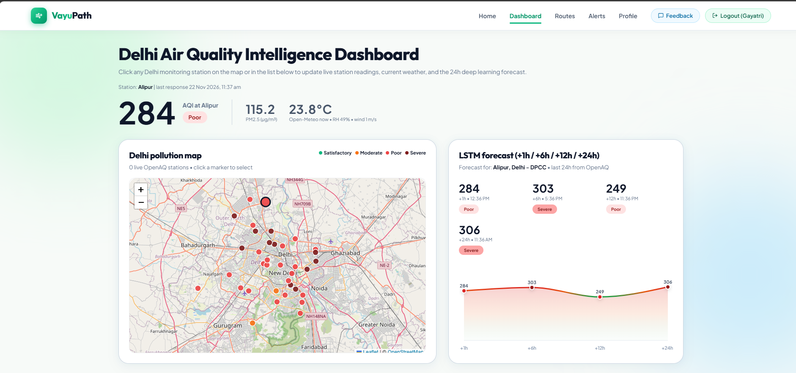
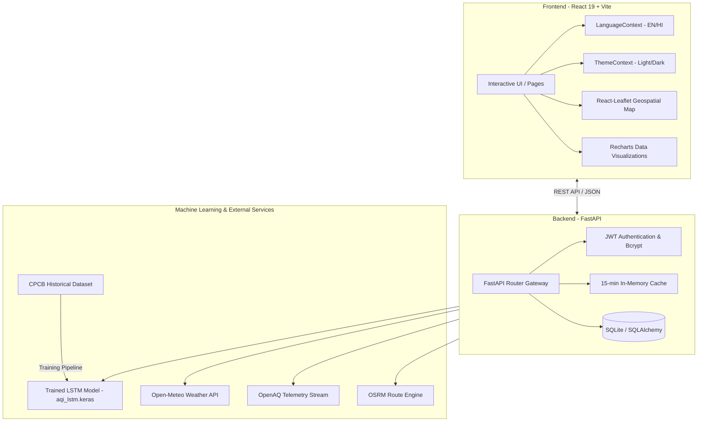

# 🌿 Vayu Path – AI-Powered Air Quality Intelligence & Route Optimization

[](https://www.python.org/)
[](https://fastapi.tiangolo.com/)
[](https://react.dev/)
[](https://vitejs.dev/)
[](https://www.tensorflow.org/)
[](https://leafletjs.com/)

An end-to-end intelligent environmental intelligence platform that combines **real-time air quality telemetry**, **deep learning multi-horizon forecasting (LSTM)**, **pollution-aware green route optimization (OSRM + Geospatial Interpolation)**, **personalized health-risk alerts with atmospheric radar sweep**, and a **bilingual (English & Hindi) dark/light responsive interface**.

---

## 📌 Table of Contents

- [Key Highlights](#-key-highlights)
- [System Architecture](#-system-architecture)
- [Machine Learning Pipeline](#-machine-learning-pipeline)
- [Core Application Modules](#-core-application-modules)
  - [1. Landing & Product Showcase](#1-landing--product-showcase)
  - [2. Authentication & Session Security](#2-authentication--session-security)
  - [3. Home Hub & 24h Forecast Trend](#3-home-hub--24h-forecast-trend)
  - [4. Live Telemetry & Forecast Dashboard](#4-live-telemetry--forecast-dashboard)
  - [5. Green Route Optimizer (Pollution-Aware Pathfinding)](#5-green-route-optimizer-pollution-aware-pathfinding)
  - [6. Personalized Alerts & Atmospheric Radar Sweep](#6-personalized-alerts--atmospheric-radar-sweep)
  - [7. Profile, Health Sensitivity & Customization Engine](#7-profile-health-sensitivity--customization-engine)
  - [8. Interactive In-App Feedback System](#8-interactive-in-app-feedback-system)
- [Tech Stack](#-tech-stack)
- [Repository Structure](#-repository-structure)
- [API Reference](#-api-reference)
- [Installation & Quickstart Guide](#-installation--quickstart-guide)
  - [Prerequisites](#prerequisites)
  - [Backend Setup](#1-backend-setup)
  - [Frontend Setup](#2-frontend-setup)
- [CPCB Air Quality Index (AQI) Categorization](#-cpcb-air-quality-index-aqi-categorization)

---

## 🚀 Key Highlights

* **🧠 Deep Learning Forecasts:** Multi-layer LSTM recurrent neural network forecasting AQI across multiple horizons (**+1h, +6h, +12h, and +24h**) using historical pollutant concentrations and cyclical temporal embeddings.
* **📍 40+ Delhi CAAQMS Monitoring Stations:** Continuous telemetry integration connecting CPCB, DPCC, and OpenAQ sensors for $\text{PM}_{2.5}$, $\text{PM}_{10}$, $\text{NO}_2$, $\text{SO}_2$, $\text{CO}$, and $\text{O}_3$.
* **🛣️ Pollution-Aware Green Routing:** Integrates Open Source Routing Machine (OSRM) with inverse distance weighting (IDW) geospatial interpolation to calculate and compare travel paths, recommending routes that minimize respiratory exposure.
* **🔔 Smart Health-Risk Alerts & Radar Sweep:** Configurable health profiles (General, Children, Senior Citizens, Asthmatic, Cardio-Vascular) with custom threshold triggers, web push notifications, and an animated atmospheric radar sweep.
* **🌐 Full Bilingual Translation (English & Hindi):** Seamless, dictionary-driven React context engine translating all typography, labels, validations, alerts, and navigation links.
* **🌓 Premium Dark/Light Theme Engine:** Adaptive styling with smooth cubic-bezier transitions (`0.4s ease`) and high-contrast color palettes for comfortable day/night usage.
* **⚡ Ultra-Low Latency Caching:** 15-minute in-memory caching for live weather and inference pipelines, cutting station loading times down to $<50\text{ms}$.


---

## Screenshots

### Landing Page


---

### Register Page


---

### Login Page


---

### Home Page


---

### Route Advisory


---

### Live Dashboard


---

### Alerts and Radar Sweep


---

## 🏗️ System Architecture



---

## 🔬 Machine Learning Pipeline

The core predictive engine uses an **LSTM (Long Short-Term Memory)** recurrent neural network specifically designed for time-series air quality regression.

### 1. Data Collection & Preprocessing
* **Dataset:** Delhi continuous ambient air quality monitoring station records (`delhi_cpcb_hourly.csv`) containing hourly pollutant readings ($\text{PM}_{2.5}$, $\text{PM}_{10}$, $\text{NO}_2$, $\text{SO}_2$, $\text{CO}$, $\text{O}_3$).
* **Temporal Encoding:** Cyclical trigonometric transforms for seasonal and diurnal variations:
  $$\text{hour\_sin} = \sin\left(\frac{2\pi \cdot \text{hour}}{24}\right), \quad \text{hour\_cos} = \cos\left(\frac{2\pi \cdot \text{hour}}{24}\right)$$
  $$\text{month\_sin} = \sin\left(\frac{2\pi \cdot \text{month}}{12}\right), \quad \text{month\_cos} = \cos\left(\frac{2\pi \cdot \text{month}}{12}\right)$$
* **Feature Scaling:** Robust and MinMax normalizers saved via `scaler.pkl` and `target_scaler.pkl`.

### 2. Neural Network Architecture
* **Sequential Layering:** Two recurrent LSTM layers with Dropout ($0.2$) and Batch Normalization for stability.
* **Dense Output Layer:** Multi-horizon regression head producing predictions for $+1\text{h}$, $+6\text{h}$, $+12\text{h}$, and $+24\text{h}$ intervals.
* **Evaluation Metrics:** Mean Squared Error (MSE), Root Mean Squared Error (RMSE), and Mean Absolute Error (MAE).

---

## 💻 Core Application Modules

### 1. Landing & Product Showcase
* Clean landing layout featuring hero statements, quick feature matrices, active live station telemetry previews, and streamlined navigation into the portal.

### 2. Authentication & Session Security
* **Endpoints:** `/auth/signup`, `/auth/login`, `/auth/me`.
* **Security:** Password hashing with **Bcrypt**, cryptographically signed **JWT access tokens**, and automatic session validation.
* **Route Guarding:** Client-side `ProtectedRoute` and `PublicRoute` wrappers preventing unauthorized page access and invalid redirects.

### 3. Home Hub & 24h Forecast Trend
* Comprehensive dashboard entry displaying current Delhi-wide AQI status, localized safety cards, and an interactive **24-Hour Forecast Trend chart** rendered with an SVG area gradient and dynamic risk dots.

### 4. Live Telemetry & Forecast Dashboard
* Interactive Leaflet map with pulsing, color-coded markers for 40+ Delhi monitoring stations (Connaught Place, Anand Vihar, Punjabi Bagh, RK Puram, IGI Airport, etc.).
* Live weather panel fetching temperature, humidity, wind velocity, and wind direction via Open-Meteo.
* Deep learning forecast breakdown across 1h, 6h, 12h, and 24h prediction horizons.
* Historical 24-hour progression charts for $\text{PM}_{2.5}$ and $\text{NO}_2$.

### 5. Green Route Optimizer (Pollution-Aware Pathfinding)
* Computes multiple route alternatives between starting and destination points in Delhi via OSRM.
* Performs **Geospatial Inverse Distance Weighting (IDW)** along GPS waypoints against regional CAAQMS stations.
* Directly compares the **Safest Route (AI Preferred)** against the **Fastest Alternative Route**, highlighting exposure percentage reduction and health safety travel advisories.
* Logs route history directly to user accounts for repeated trip analysis.

### 6. Personalized Alerts & Atmospheric Radar Sweep
* Atmospheric radar scanner interface with animated conic-gradient sweeps and live forecast breach evaluations.
* Customizable health vulnerability profiles:
  * **General Public** ($\text{AQI } 150$)
  * **Children** ($\text{AQI } 100$)
  * **Senior Citizens** ($\text{AQI } 100$)
  * **Asthmatic Patients** ($\text{AQI } 80$)
  * **Cardio-Vascular Concerns** ($\text{AQI } 80$)
* Full integration with the browser **Notification API** for desktop push alerts when predictions breach user thresholds.
* Real-time notification log with read/unread tracking and feed management.

### 7. Profile, Health Sensitivity & Customization Engine
* Manage user credentials (name, email, password update).
* Customize AQI safety thresholds with a smooth interactive slider ($30\text{--}300\text{ AQI}$).
* **Language Switcher:** Toggle between **English** and **Hindi** with localized typography across all pages.
* **Theme Switcher:** Toggle between **Light Mode** and **Dark Mode** with hardware-accelerated CSS transition smoothing.

### 8. Interactive In-App Feedback System
* Floating modal widget accessible across all views.
* Supports category selection (UI/UX Design, Bug Report, Feature Suggestion, General Feedback), interactive 5-star ratings, and custom comment submission.

---

## 🛠️ Tech Stack

| Layer | Technology | Description |
| :--- | :--- | :--- |
| **Frontend Framework** | React 19 | Component-driven UI library with modern hook architecture |
| **Build Tool** | Vite 8 | Fast ESM-based frontend bundler |
| **Routing** | React Router v7 | Declarative client-side routing with auth guards |
| **Maps & Geospatial** | Leaflet & React-Leaflet | Mobile-friendly interactive geospatial mapping |
| **Charts & Visualizations**| Recharts | Composable SVG-based chart library |
| **Icons** | Lucide React | Clean, consistent UI icon set |
| **Backend Framework** | FastAPI | High-performance asynchronous Python web framework |
| **Server** | Uvicorn | Lightning-fast ASGI web server implementation |
| **Database & ORM** | SQLite & SQLAlchemy | Relational data persistence for users, routes, alerts, feedback |
| **Auth & Security** | PyJWT & Passlib (Bcrypt) | Secure password hashing and token-based authentication |
| **Machine Learning** | TensorFlow / Keras (LSTM) | Time-series deep learning neural network for forecasting |
| **Data Processing** | NumPy, Pandas, Scikit-Learn | Data transformation, feature engineering, and normalizers |
| **External APIs** | Open-Meteo & OpenAQ & OSRM | Weather forecasting, live air quality telemetry, and route planning |

---

## 📁 Repository Structure

```text
├── Backend/
│   ├── routers/
│   │   ├── alerts.py             # Alert evaluation & feed endpoints
│   │   ├── auth.py               # Authentication & user profile endpoints
│   │   ├── feedback.py           # In-app user feedback submission
│   │   └── routes.py             # Route optimization & history endpoints
│   ├── auth.py                   # JWT creation, decoding, and password hashing
│   ├── cpcb_service.py           # Delhi CAAQMS station coordinates & telemetry
│   ├── database.py               # SQLAlchemy database session & engine
│   ├── LSTM_services.py          # TensorFlow LSTM inference & caching engine
│   ├── main.py                   # FastAPI main application & CORS setup
│   ├── models.py                 # Database models (User, HealthProfile, RouteHistory, Alert, Feedback)
│   ├── route_services.py         # OSRM pathfinding & pollution exposure calculation
│   ├── schemas.py                # Pydantic request/response validation models
│   └── weather_services.py       # Open-Meteo weather API integration & caching
│
├── Frontend/
│   ├── src/
│   │   ├── components/
│   │   │   ├── ForecastChart.jsx # Recharts multi-point area trend visualization
│   │   │   ├── Navbar.jsx        # Navigation bar with responsive links & user status
│   │   │   └── StationCard.jsx   # Monitoring station summary card
│   │   ├── context/
│   │   │   ├── LanguageContext.jsx # Bilingual English/Hindi dictionary provider
│   │   │   └── ThemeContext.jsx    # Global Light/Dark theme provider
│   │   ├── pages/
│   │   │   ├── Alerts.jsx        # Alerts radar scope & notifications feed
│   │   │   ├── Dashboard.jsx     # Live monitoring station map & forecast cards
│   │   │   ├── Home.jsx          # User overview hub & 24h trend area chart
│   │   │   ├── Landing.jsx       # Public landing page & feature overview
│   │   │   ├── Login.jsx         # User login form with live AQI preview
│   │   │   ├── Profile.jsx       # Account, sensitivity slider, language & theme settings
│   │   │   ├── Routes.jsx        # Pollution-aware route planner & comparison
│   │   │   └── Signup.jsx        # Account registration with terms validation
│   │   ├── App.css               # Global theme variables, animations & component styles
│   │   ├── App.jsx               # Route definitions, feedback modal & auth guards
│   │   └── main.jsx              # React root mount wrapped with Context Providers
│   └── package.json              # Frontend dependencies and build scripts
│
├── data/
│   └── delhi_cpcb_hourly.csv     # Historical Delhi CPCB hourly pollutant dataset
│
├── models/
│   ├── aqi_lstm.keras            # Trained TensorFlow LSTM multi-horizon model
│   ├── feature_config.json       # Feature order and configuration metadata
│   ├── scaler.pkl                # Feature MinMax normalizer
│   └── target_scaler.pkl         # Target AQI normalizer
│
├── AI_Based_Air_Quality_Prediction_System_for_Personalized_Pollution_Alerts_and_Route_Optimization(Milestone_01).ipynb
├── AI_Based_Air_Quality_Prediction_System_for_Personalized_Pollution_Alerts_and_Route_Optimization(Milestone_02).ipynb
└── README.md
```

---

## 🔌 API Reference

### Authentication (`/auth`)
| Method | Endpoint | Description | Auth Required |
| :--- | :--- | :--- | :--- |
| `POST` | `/auth/signup` | Register a new user account | No |
| `POST` | `/auth/login` | Authenticate and obtain JWT token | No |
| `GET` | `/auth/me` | Fetch authenticated user details | Yes (Bearer Token) |
| `PUT` | `/auth/me` | Update account credentials & password | Yes (Bearer Token) |

### Dashboard (`/api/dashboard`)
| Method | Endpoint | Description | Auth Required |
| :--- | :--- | :--- | :--- |
| `GET` | `/api/dashboard/stations` | List all 40+ Delhi stations with current AQI | No |
| `GET` | `/api/dashboard/weather` | Fetch live weather for given `lat` and `lng` | No |
| `GET` | `/api/dashboard/forecast` | Run LSTM inference (+1h, +6h, +12h, +24h) for station | No |

### Routes (`/api/routes`)
| Method | Endpoint | Description | Auth Required |
| :--- | :--- | :--- | :--- |
| `POST` | `/api/routes/optimize` | Compute safest vs fastest route & pollution exposures | Yes (Bearer Token) |
| `GET` | `/api/routes/history` | Retrieve saved route search history | Yes (Bearer Token) |
| `GET` | `/api/routes/health-profile`| Fetch user health sensitivity profile | Yes (Bearer Token) |
| `PUT` | `/api/routes/health-profile`| Update sensitivity tier & AQI threshold | Yes (Bearer Token) |

### Alerts (`/api/alerts`)
| Method | Endpoint | Description | Auth Required |
| :--- | :--- | :--- | :--- |
| `GET` | `/api/alerts/feed` | Fetch user alerts notification log | Yes (Bearer Token) |
| `POST` | `/api/alerts/check` | Scan a station's forecast against user threshold | Yes (Bearer Token) |
| `PUT` | `/api/alerts/{id}/read` | Mark a specific notification as read | Yes (Bearer Token) |
| `DELETE` | `/api/alerts/clear` | Clear all alerts history | Yes (Bearer Token) |

### Feedback (`/api/feedback`)
| Method | Endpoint | Description | Auth Required |
| :--- | :--- | :--- | :--- |
| `POST` | `/api/feedback` | Submit in-app user ratings and comments | Optional |

---

## ⚡ Installation & Quickstart Guide

### Prerequisites
* **Python:** `3.10` or higher
* **Node.js:** `18.0.0` or higher
* **npm:** `9.0.0` or higher

---

### 1. Backend Setup

1. **Navigate to the Backend directory:**
   ```bash
   cd Backend
   ```

2. **Create and activate a virtual environment:**
   * **Windows (PowerShell):**
     ```powershell
     python -m venv venv
     .\venv\Scripts\Activate.ps1
     ```
   * **macOS / Linux:**
     ```bash
     python3 -m venv venv
     source venv/bin/activate
     ```

3. **Install dependencies:**
   ```bash
   pip install fastapi uvicorn sqlalchemy passlib[bcrypt] pyjwt pydantic requests python-dotenv tensorflow scikit-learn pandas numpy joblib httpx
   ```

4. **Launch the FastAPI development server:**
   ```bash
   uvicorn main:app --reload --host 127.0.0.1 --port 8000
   ```
   *The backend API documentation will be accessible at [http://127.0.0.1:8000/docs](http://127.0.0.1:8000/docs).*

---

### 2. Frontend Setup

1. **Open a new terminal and navigate to the Frontend directory:**
   ```bash
   cd Frontend
   ```

2. **Install Node dependencies:**
   ```bash
   npm install
   ```

3. **Start the Vite development server:**
   ```bash
   npm run dev
   ```
   *The client web application will be accessible at [http://localhost:5173](http://localhost:5173).*

4. **Build for Production (Optional):**
   ```bash
   npm run build
   ```

---

## 📊 CPCB Air Quality Index (AQI) Categorization

The platform strictly adheres to the official **Central Pollution Control Board (CPCB)** air quality standard brackets:

| AQI Range | Category | Color Code | Health Implication |
| :--- | :--- | :--- | :--- |
| **0 – 50** | **Good** | 🟢 `#10b981` | Minimal health impact; optimal for outdoor activities. |
| **51 – 100** | **Satisfactory** | 🟢 `#22c55e` | Minor breathing discomfort to sensitive individuals. |
| **101 – 200** | **Moderate** | 🟡 `#eab308` | Breathing discomfort to people with lung, asthma, and heart conditions. |
| **201 – 300** | **Poor** | 🟠 `#f97316` | Breathing discomfort to most people on prolonged exposure. |
| **301 – 400** | **Very Poor** | 🔴 `#ef4444` | Respiratory illness on prolonged exposure; severe effects on sensitive groups. |
| **401 – 500+**| **Severe** | 🟣 `#7f1d1d` | Affects healthy people and seriously impacts those with existing diseases. |

---

## 📄 License & Attribution

Developed as part of the **Vayu Path – AI-Based Air Quality Prediction & Route Optimization Project (2026)**. Built with ❤️ for cleaner air, smarter mobility, and proactive public health protection.
